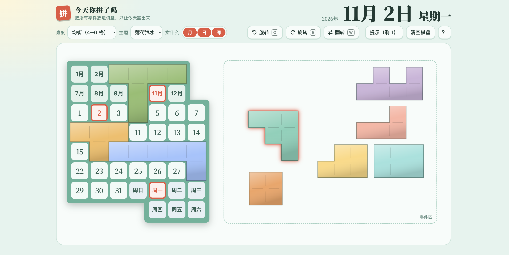

# 今天你拼了吗

> 一个日历七巧板小游戏 —— 把所有零件放进棋盘，只让**今天**露出来，每天一题。

<p align="center">
  <a href="https://kK-2004.github.io/daily-tangram/"><strong>🎮 在线游玩：https://kK-2004.github.io/daily-tangram/</strong></a>
</p>

<p align="center">
  
</p>

<p align="center">
  
  
  
  
</p>

## 🧩 玩法

棋盘是一个真实的日历：**12 个月 + 31 天 + 7 个星期**，共 50 格。系统把「今天以外的格子」随机切分成若干个多连块零件，你的任务是——

**把所有零件放回棋盘，只让今天的月、日、星期露出来。**

- 🖱️ 拖动零件，松手自动吸附到格子
- 👆 轻点零件 = 顺时针旋转；`Shift` + 轻点 / 右键 = 翻转
- ⌨️ 选中零件后：<kbd>Q</kbd> 逆时针 · <kbd>W</kbd> 翻转 · <kbd>E</kbd> 顺时针 · <kbd>Esc</kbd> 取消
- 🔴 零件会盖住今天的日期时，吸附预览变**红色虚线**并拒绝放置
- 💡 每天 1 次提示，自动放好一块零件
- 🔘 按钮栏的「拼什么」开关：月 / 日 / 周哪几项露出（自由组合玩法）

## ✨ 特性

- **每日一题，全网同步** —— 每天 23:00（北京时间）由 Supabase Edge Function 自动生成下一天的拼盘写入数据库，所有玩家拼的是同一套
- **纯前端单文件** —— 整个游戏就是一张 `index.html`，零构建、零框架，打开即玩
- **完成排行** —— 弹窗显示「你是今日第 N 位 / 本次用时 / 今日最快」，底部状态栏展示今日与累计完成人数
- **移动端适配** —— 单屏不滚动；零件区比棋盘更宽、自动横排；选中零件浮现旋转/翻转按钮
- **8 套主题** —— 内置青瓷、樱花、宣纸朱印、薄荷汽水、原木、水墨、夜空、霓虹，JSON 配置化，按 `theme/index.json` 顺序展示
- **三种难度** —— 大块（5–7 格）/ 均衡（4–6 格）/ 细碎（3–5 格），不同难度与拼法组合各自成题
- **无解自动重生成** —— 拼盘生成时内嵌答案保证有解；本地兜底模式下经求解器校验，无解自动换一套
- **深色模式** —— 跟随系统，夜空主题自动上车

## 🚀 快速开始

```bash
# 任选其一
open index.html                 # 直接双击也能玩
python3 -m http.server 8000     # 本地起个服务：http://localhost:8000
```

部署到 GitHub Pages：推送到 `main` / `master` 分支即可，[.github/workflows/deploy.yml](.github/workflows/deploy.yml) 会自动构建发布。

## ☁️ 接入 Supabase（可选）

不配置也能玩（纯本地模式）；配置后解锁**全网同一套拼盘 + 完成排行 + 累计人数**。

1. [supabase.com](https://supabase.com) 创建项目
2. SQL Editor 中执行 [supabase-setup.sql](supabase-setup.sql)（建表 + RLS + 统计函数，一次搞定）
3. 仓库 **Settings → Secrets and variables → Actions** 添加两个 Secret：
   - `SUPABASE_URL`：Project URL
   - `SUPABASE_ANON_KEY`：anon public key（可公开，配合 RLS 使用）
4. 部署函数：Dashboard → Edge Functions → 新建 `gen-daily`，粘贴 [supabase/functions/gen-daily/index.ts](supabase/functions/gen-daily/index.ts)
5. Dashboard → Integrations → Cron 创建两个定时任务（**pg_cron 按 UTC 调度**）：

| 任务 | Schedule（UTC） | 北京时间 | 内容 |
|---|---|---|---|
| `gen-daily-puzzle` | `0 15 * * *` | 每天 23:00 | 调 `gen-daily` 函数，生成下一天 24 套拼盘 |
| `rollup-daily-stats` | `30 16 * * *` | 每天 0:30 | `rollup_day` 把前一天完成人数累加进全局总数 |

> 即使 Cron 还没跑，第一个打开新一天的玩家也会本地生成并**乐观锁**（首写生效）补传拼盘，不会开天窗。

## 📁 目录结构

```
├── index.html                        # 整个游戏（HTML + CSS + JS 单文件）
├── theme/
│   ├── index.json                    # 主题清单，顺序即下拉框顺序
│   └── *.json                        # 各主题配色（celadon / sakura / night …）
├── supabase-setup.sql                # 建表 + RLS + 统计/汇总函数（一键执行）
├── supabase/functions/gen-daily/     # 每日拼盘生成 Edge Function
└── .github/workflows/deploy.yml      # Pages 部署 + Secrets 注入
```

## 🎨 添加主题

在 `theme/` 里新建一个 JSON，并登记进 `theme/index.json`：

```json
{
  "id": "aurora",
  "name": "极光",
  "dark": false,
  "vars": { "accent": "#7c5cff" },
  "pieces": ["#7c5cff", "#00c2a8", "#ffb347"]
}
```

`vars` 只需写与默认不同的 CSS 变量，`pieces` 是零件循环取色盘。

## 🛠️ 技术细节

- **拼盘生成**：把当日需覆盖的格子随机切分成多连块（重复形状最少优先），答案直接内嵌在数据里，天然有解
- **求解器**：带回溯剪枝的精确覆盖搜索，跑在 Web Worker 里，不卡界面
- **统计口径**：全站「今天」统一按北京时间（UTC+8）计算；`timestamptz` 底层 UTC 存储，展示时转本地时区
- **本地兜底**：未接入 Supabase 时，拼盘/进度/提示次数都在本机 localStorage，断网也能玩

---

*每天打开，拼一下今天。* 📅
